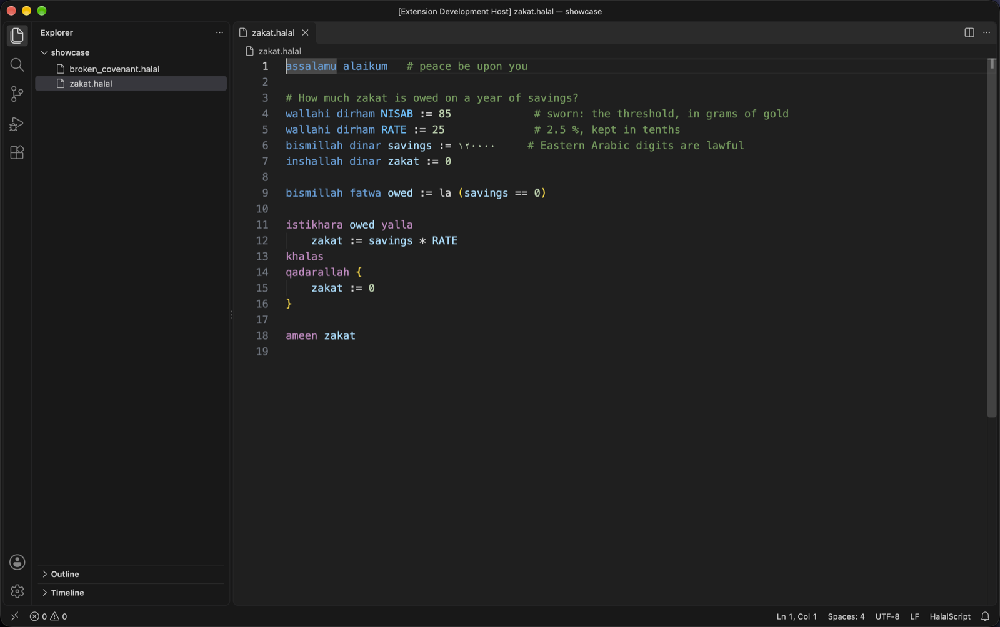
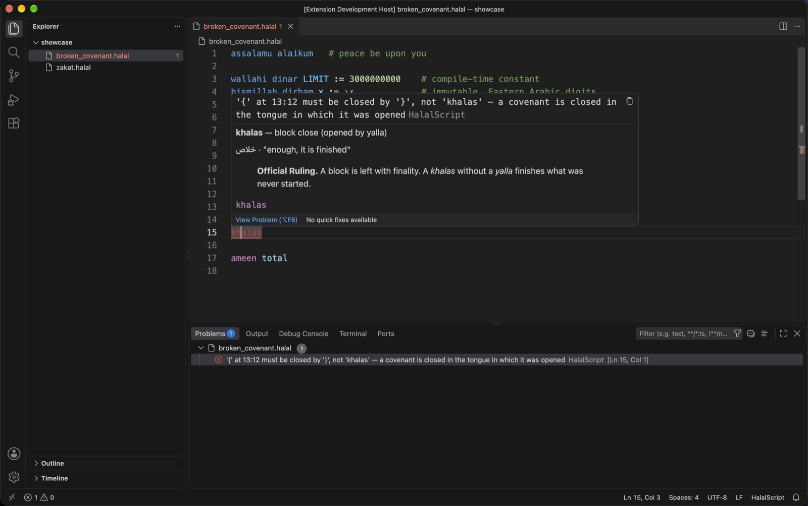
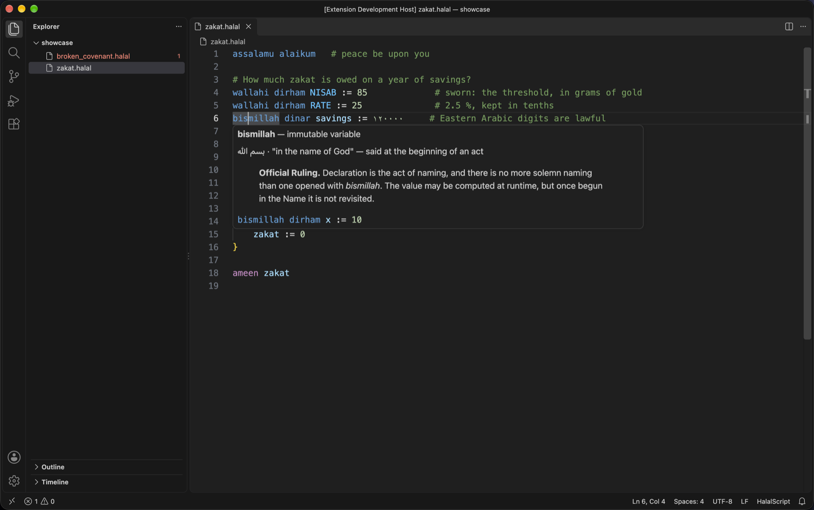
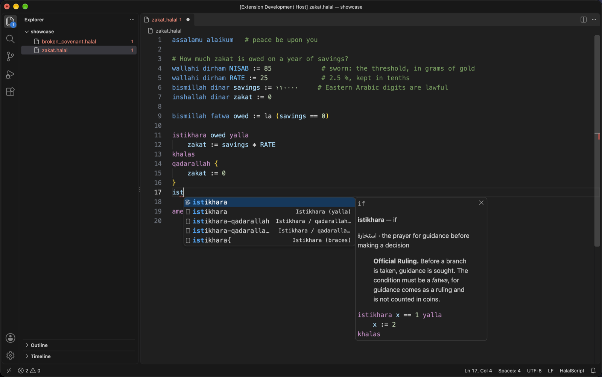
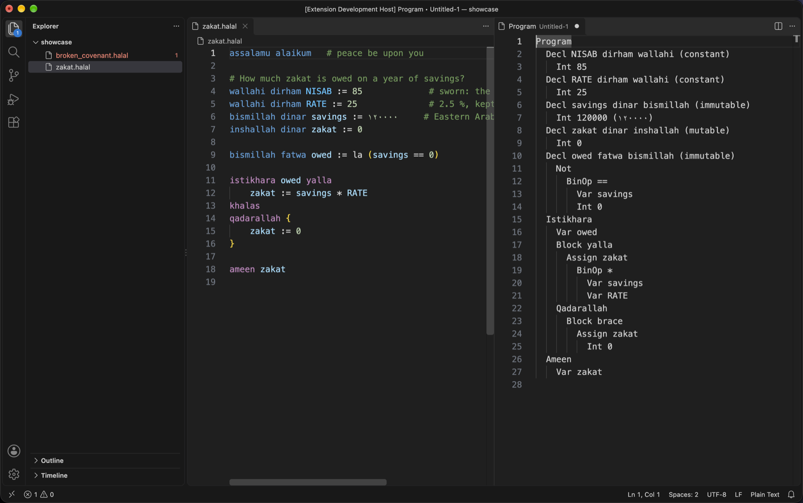
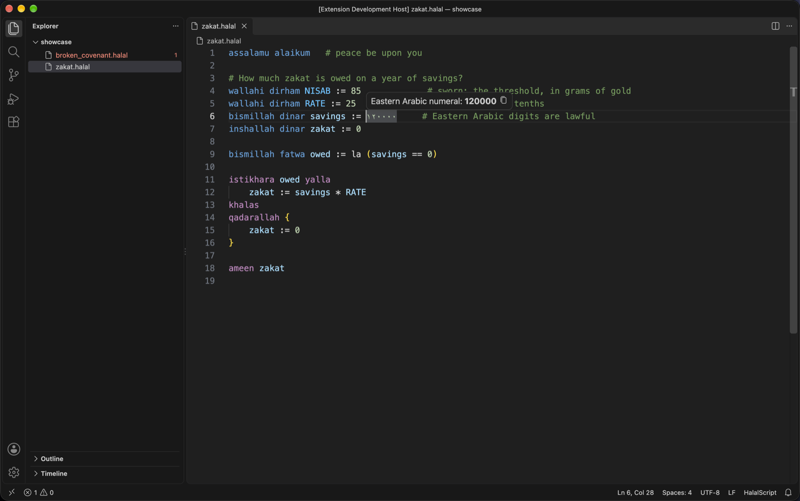

# HalalScript for VS Code

Language support for [HalalScript](../README.md) files (`.halal`).

- **Highlighting** of declarations (`wallahi`, `bismillah`, `inshallah`), the types
  (`dirham`, `dinar`, `fatwa`), `halal`/`haram`, control words, operators, Western
  and Eastern Arabic numerals and `#` comments; a lone `=`, `!` or `:` shows as invalid.
- **Live compiler verdicts**: the bundled compiler checks the file as you type,
  and its error is underlined at the exact `line:column`.
- **Hover** on a keyword shows its meaning and its Official Ruling; on a name, its
  declaration; on an Arabic numeral, its value.
- **Completion** of keywords (with their rulings) and declared names.
- **Snippets**: `assalamu` (whole program), `bismillah` / `inshallah` / `wallahi`,
  `istikhara`, `istikhara{`, `istikhara-qadarallah`, `qadarallah` and the brace versions.
- **Editor**: `#` comment toggling, `yalla`/`khalas` matched like brackets,
  indentation after `yalla` and `{`, auto-closing `(` and `{`.
- **Commands**: *HalalScript: Convert digits to Eastern Arabic* (`Ctrl+Cmd+A`
  on macOS, `Ctrl+Alt+A` elsewhere), *Convert digits to Western (0-9)*, and
  *Show the syntax tree* (the `--ast` dump beside the program).

## Screenshots

**Highlighting** — declarations, types, control words, `la`, Western and Eastern
Arabic numerals, operators and comments.



**The compiler's verdict, as you type** — the closer of a broken covenant is
underlined; the hover and the Problems panel show the compiler's message.



**The Official Ruling on hover**



**Completion with documentation, and the snippets**



**The syntax tree beside the program** (*HalalScript: Show the syntax tree*)



**Eastern Arabic numerals** — their value on hover.



The screenshots are produced by `npm run screenshots` (macOS): it opens
`test/showcase` in a downloaded VS Code, sets up each scene with VS Code
commands, and captures the screen.

## Requirements

Requires Python 3.10+ on the PATH (setting `halalscript.pythonPath`). The setting
`halalscript.compilerPath` points the extension at another `compiler.py`.

## Build, test and install

```sh
cd vscode-halalscript
npm install
npm test                 # grammar tests + integration tests in a downloaded VS Code
npm run package          # builds halalscript-0.1.0.vsix
code --install-extension halalscript-0.1.0.vsix
```

To try it without installing, open this folder in VS Code and press F5.

Then open [`../examples/tour.halal`](../examples/tour.halal): hover the keywords,
and follow the experiments in its comments to see the errors appear.
