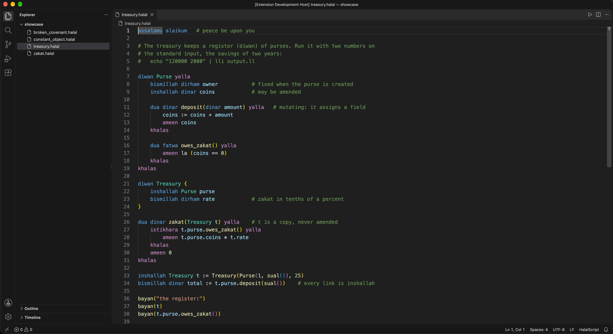
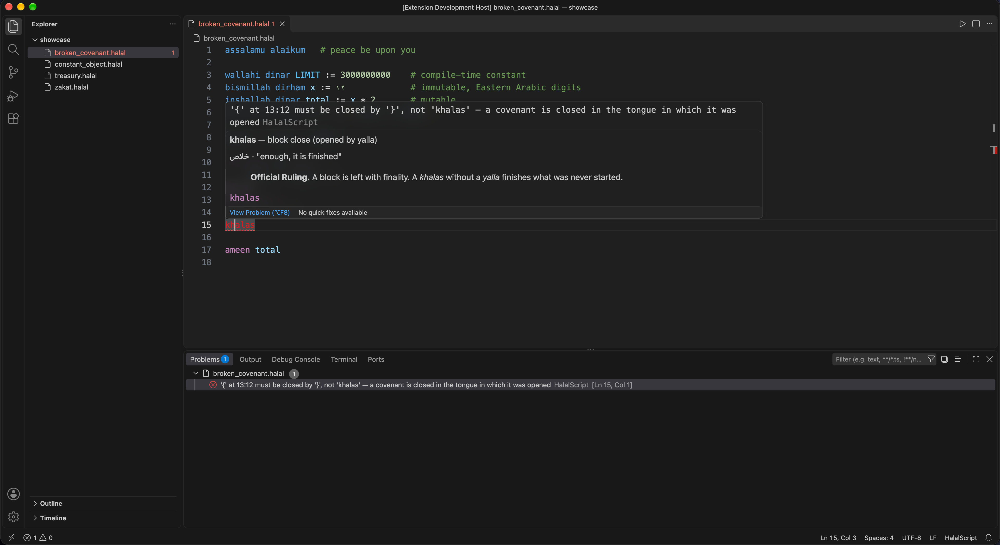
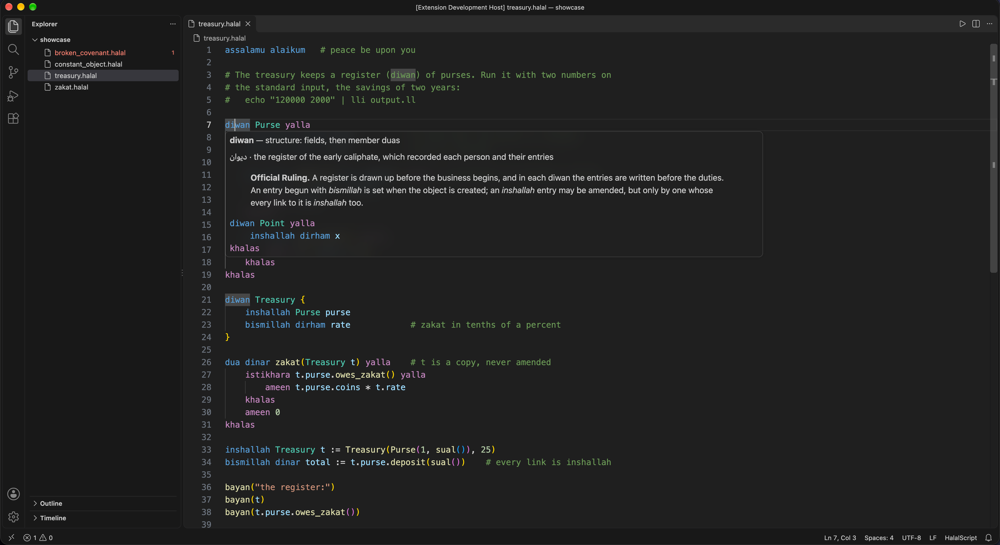
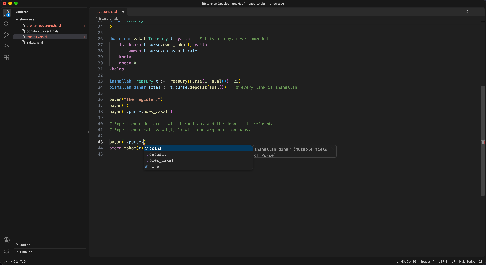
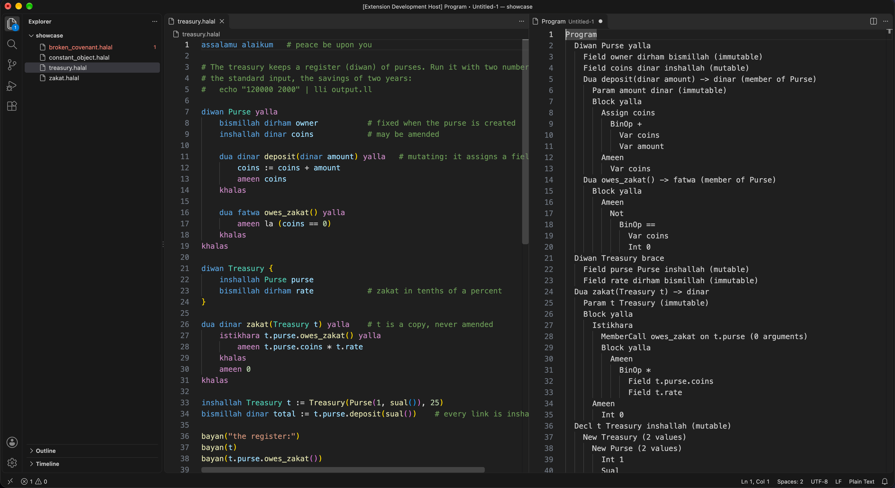
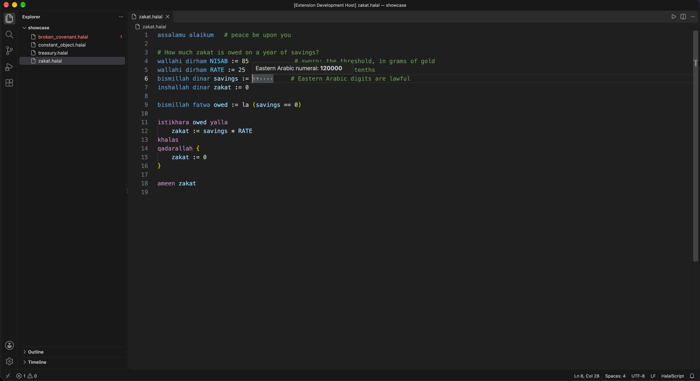
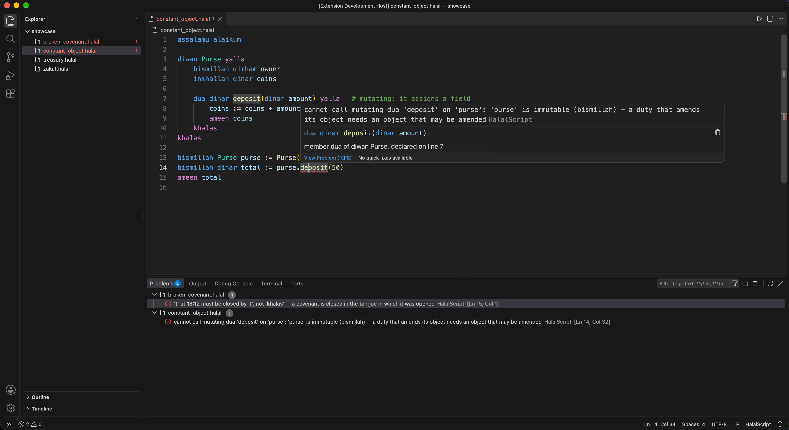
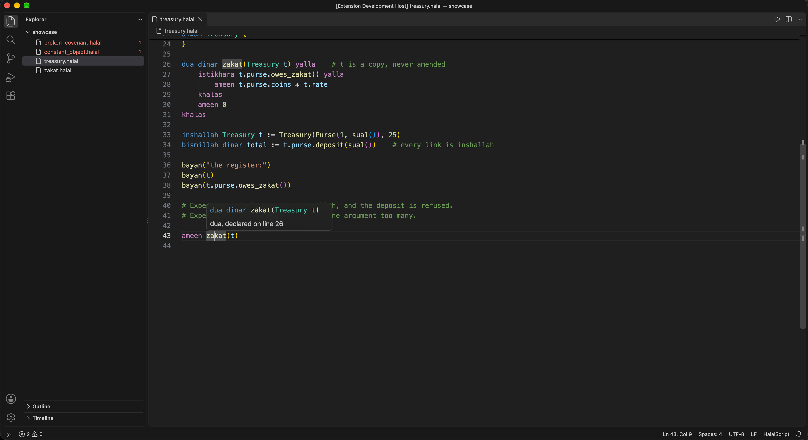
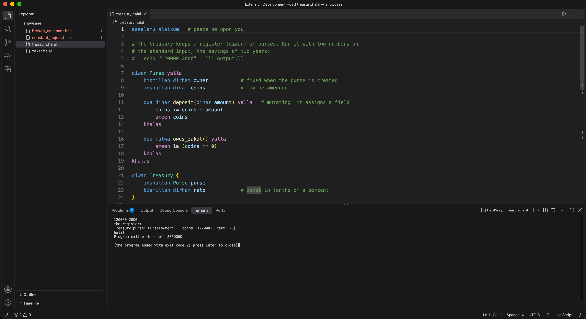

# HalalScript for VS Code

Language support for [HalalScript](../README.md) files (`.halal`), for the
whole language of stage 2: diwans, duas, field chains, `sual` and `bayan`.

- **Highlighting** of declarations (`wallahi`, `bismillah`, `inshallah`), the types
  (`dirham`, `dinar`, `fatwa` and diwan names), `diwan` and `dua` headers with their
  names and parameters, calls, member calls and field chains, `sual` and `bayan`,
  string literals (an unclosed one shows as invalid), `halal`/`haram`, control
  words, operators, Western and Eastern Arabic numerals and `#` comments; a lone
  `=`, `!` or `:` shows as invalid.
- **Live compiler verdicts**: the bundled compiler checks the file as you type,
  syntax and semantics alike (types, mutability, arguments, mutating duas called
  on constant objects), and its error is underlined at the exact `line:column`.
- **Hover** on a keyword shows its meaning and its Official Ruling; on a name, its
  declaration; on a dua or its call, its signature; on a diwan, its fields and
  member duas; on a field in a chain such as `t.purse.coins`, the field and its
  diwan; on an Arabic numeral, its value. Inside a dua, a name resolves as the
  compiler resolves it: parameters and locals, then the fields of its diwan,
  never the top-level variables.
- **Completion** of keywords (with their rulings), the names a line can see, duas
  (with parentheses) and diwans; after `chain.`, only the fields and member duas
  of the diwan the chain reaches.
- **Snippets**: `assalamu` (whole program), `bismillah` / `inshallah` / `wallahi`,
  `istikhara`, `istikhara-qadarallah`, `qadarallah`, `diwan`, `field`, `dua`,
  `bayan`, `sual`, and the `{ }` versions of the blocks (`istikhara{`, `diwan{`, `dua{`, …).
- **Editor**: `#` comment toggling, `yalla`/`khalas` matched like brackets,
  indentation after `yalla` and `{`, auto-closing `(`, `{` and `"`.
- **Commands**:
  - *HalalScript: Run the program* (also the ▷ button of the editor) compiles the
    file to LLVM IR and runs it under `lli` in a terminal, where `sual()` reads
    what you type. It runs only in a trusted workspace.
  - *HalalScript: Show the syntax tree* opens the `--ast` dump beside the program.
  - *Convert digits to Eastern Arabic* (`Ctrl+Cmd+A` on macOS, `Ctrl+Alt+A`
    elsewhere) and *Convert digits to Western (0-9)*.

## Screenshots

**Highlighting**: diwans and their fields, duas with their parameters, member
calls and field chains, `sual`, `bayan` and a string.



**A syntax error, as you type**: the closer of a broken covenant is underlined;
the hover and the Problems panel show the compiler's message.



**The Official Ruling on hover**



**Completion after a chain**: only the fields and member duas of `Purse`, the
diwan `t.purse` reaches.



**The syntax tree beside the program** (*HalalScript: Show the syntax tree*)



**Eastern Arabic numerals**: their value on hover.



**A semantic error, as you type**: a mutating dua called on a `bismillah` object.



**A dua's signature on hover over its call**



**Running the program** (*HalalScript: Run the program*): the two numbers typed
in the terminal are what `sual()` reads.



The screenshots are produced by `npm run screenshots` (macOS: it uses
`screencapture`): it opens `test/showcase` in a downloaded VS Code, sets up each
scene with VS Code commands, and captures the screen. The run scene needs
`HALALSCRIPT_PYTHON` (a Python with llvmlite) and `LLI` (the path of `lli`) in
the environment.

## Requirements

- Highlighting, hover, completion and snippets need nothing else.
- Live verdicts and the syntax tree need Python 3.10+ (setting
  `halalscript.pythonPath`). They do not need llvmlite.
- *Run the program* also needs [llvmlite](https://llvmlite.readthedocs.io)
  installed for that Python, and LLVM's `lli` (setting `halalscript.lliPath`).
  When one is missing, the terminal says which and how to fix it.
- `halalscript.compilerPath` points the extension at another `compiler.py`.

In Restricted Mode these three paths come only from your user settings, and no
program is run.

## Build, test and install

```sh
cd vscode-halalscript
npm install
npm test                 # grammar tests + integration tests in a downloaded VS Code
npm run package          # builds halalscript-0.2.0.vsix
code --install-extension halalscript-0.2.0.vsix
```

To try it without installing, open this folder in VS Code and press F5.

Then open [`../examples/treasury.halal`](../examples/treasury.halal): hover the
names, type `t.purse.` to see the completion, and run it with the ▷ button.
